# KAMCO walkthrough: from tender email to contract project

Snapshot 2026-11-01. The screens after the October redesign. Every step has one picture. A red box and a red number mark where to click; the number matches the step. Pictures are from the KAMCO workspace, on TEST data only.

Labels in **bold** are exactly as shown on screen. An "i" icon next to a label opens a short explanation: use it instead of guessing.

## What changed

| Before | Now | Where |
|---|---|---|
| Eight tabs and no start or end | One path across the top: **Received, Decision, BOQ, Costing, Bid, Submitted, Won or lost**, with one **Next** row | Tender |
| Several chips always open | One **Details** row, closed until you open it | Tender |
| **Source**, **Mk**, **Rate**, **Linked** | **Cost from**, **Markup %**, **Rate / unit**, **Product**, each with an "i" | BOQ |
| "12 lines not priced" pill | The **Priced** tile: "6 of 12 · 6 to price" | BOQ |
| Cost could only be set from Costing | **Cost / unit** and **Save cost** in the row panel | BOQ |
| **Estimates and RFQs** cards | **Cost sources**, one table | Costing |
| **Price more BOQ rows** | **Add rows** | Costing |
| **Create quote** on a tender estimate | **Back to Costing** (or **Back to BOQ line n**) | Estimate |
| Bid email sent outside the tender | **Send by email** and **Sent to client** on the Bid tab | Bid |
| Payment terms typed by hand | **Payment terms** template chosen on the Bid tab | Bid |
| Client email outside the system | **Interactions** tab: one timeline and **New email** | Tender |
| One long room, open questions | Room sub-tabs **Discussion, Team, Decisions, Documents**; open questions removed | Room |
| Competitor cards | One list (Company, Expected price, Status); click a row for the evidence | Competitors |
| **Suggest from market research** | Asks three questions first, then proposes competitors with a source for every fact | Competitors |
| Project budget made by the system | You allocate it: **Allocate by** **BOQ line** or **Work package** | Contract project |
| **Variations** | **Client changes** | Contract project |
| **Invoicing** | **Client billing** | Contract project |
| **Committed**, **Actual** | **Ordered**, **Spent** | Budget, Buy-out |
| Default margin setting | **Margin floor** (Settings, Contract projects) | Settings |
| **Handover** | **Hand over to the ERP** | Contract project |

## A. From the email to a tender

1. Open the **Inbox** and click the email. 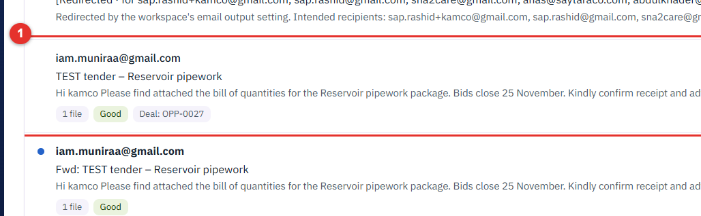
2. Click **Create from this email**. On a new email it offers what to create (a deal or tender). On this one it is greyed out, because the email already became a deal ("This email became Deal OPP-0027."). 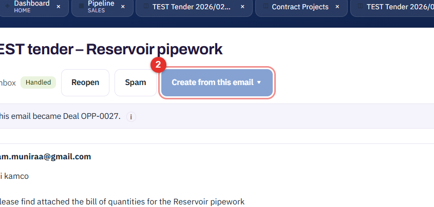

Or start a tender by hand: Pipeline, **New tender**.

3. In **New tender**, click **Account** and choose the issuer's account (required). 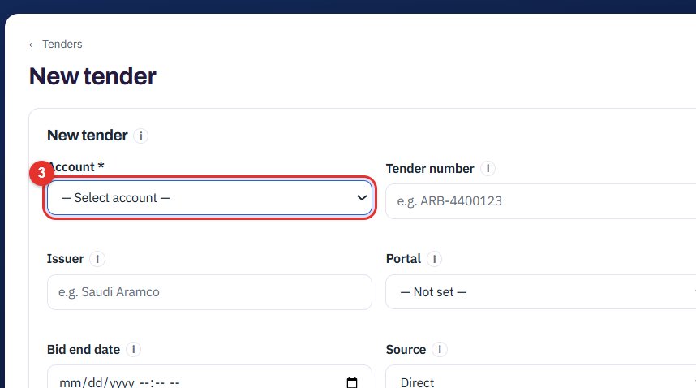
4. Click **Tender number** and type the client's number. 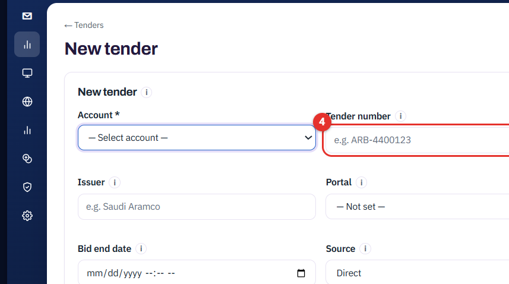
5. Click **Save**. The tender opens at stage Received. 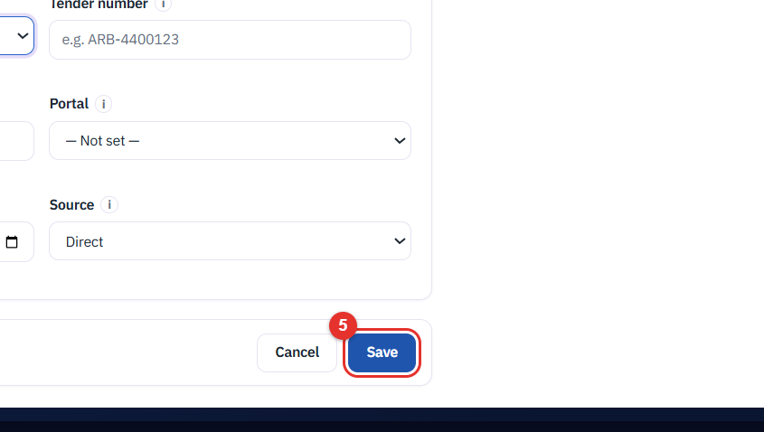

## B. The tender screen

6. Read the path across the top. The dark dot is where you are. 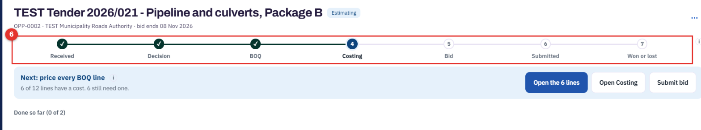
7. The blue **Next** row says what to do now and gives one main button. Here: **Open the 6 lines** opens the lines that still need a cost. At stage Received the button is **Propose bid decision**; an approver then approves it. 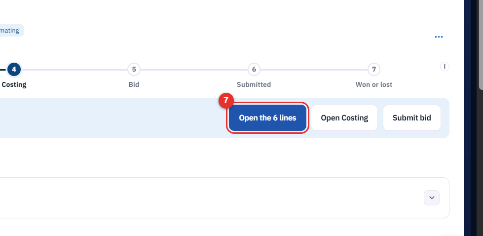
8. Click **Details** to open the facts: amount, stage, bid decision, bid end date, bid guarantee. It stays closed by default and remembers your choice. 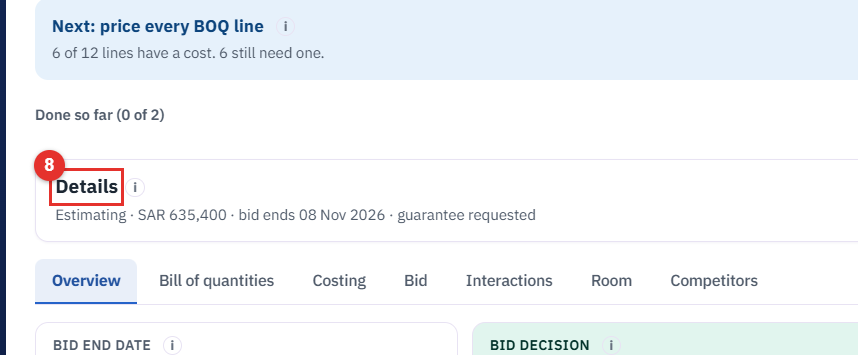
   Result: 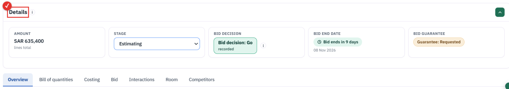

## C. Bill of quantities

9. Click **Bill of quantities**. 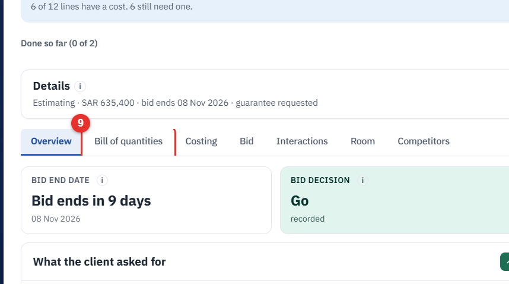
10. Click **Upload revised BOQ** to load the client's .xlsx. The columns are read for you; check them, then create the lines. 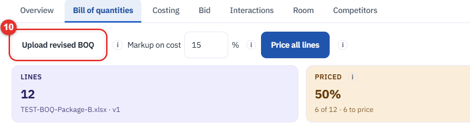
    Your own Excel works as it is, with its own columns. If you have none, click **Download BOQ template** (next to the upload button) for a starting file. The preview shows **Project code** and **Project name** read from the title block of your file. Click a row to see its **Details** (the long Description) and, collapsed, **Client columns** (Sr #, Bill #, Section, Page # and so on). Limits: 2,000 lines and 15 MB.
11. Set **Markup on cost** (%). It is added on the cost to make the rate. 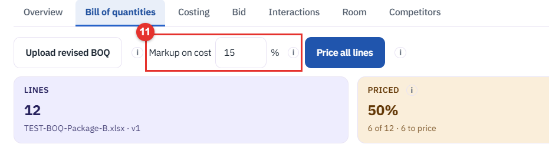
12. Click **Price all lines**. It uses supplier, then BOM, then past project, fresh prices only. 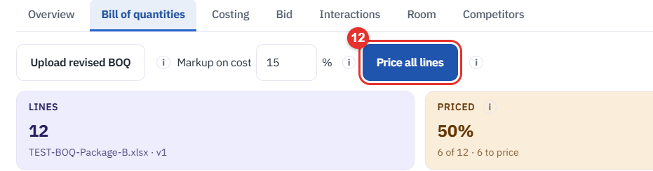
13. Read the **Priced** tile: "6 of 12 · 6 to price". 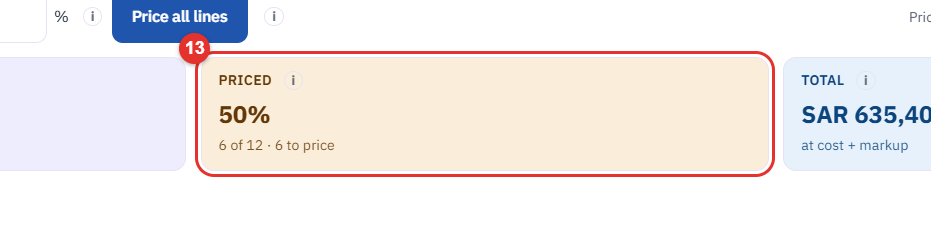
14. Click the "i" beside **Cost from** to see where a cost came from. Every column head has one. 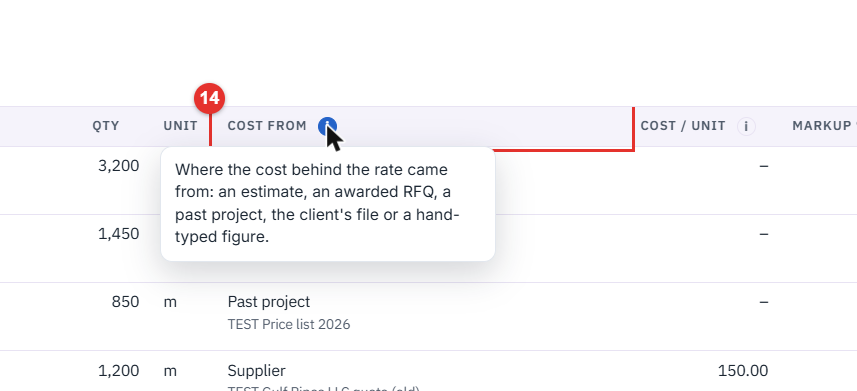
15. Click an item number (here **2.2**) to open the row. 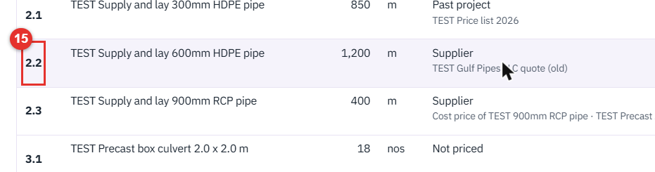
    Result: the row panel with **Where the cost came from**. 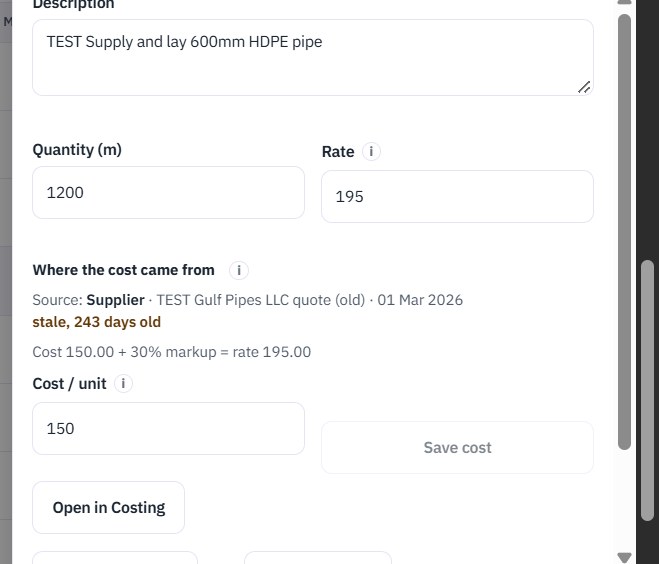
16. In the panel, click **Cost / unit** and type your own cost. 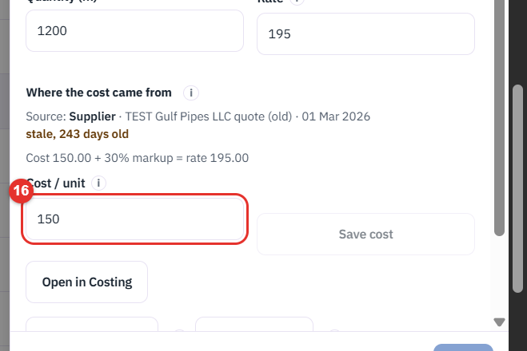
17. Click **Save cost**. It is saved as Manual and keeps the source it replaced. The button stays grey until the cost changes. 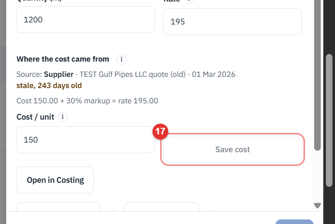

## D. Costing, RFQ, estimate, award

18. Click **Costing**. The four tiles count rows priced, rows that still need a cost, RFQs out and replies in. 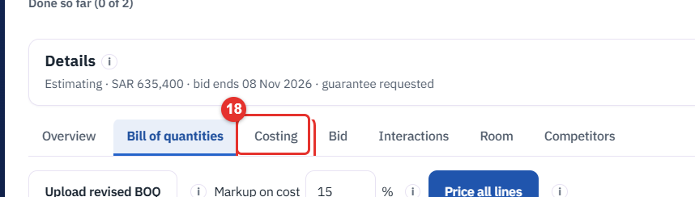
19. Read **Cost sources**: one table of estimates and RFQs, with the BOQ rows each one prices. Each BOQ row takes its cost from one source. 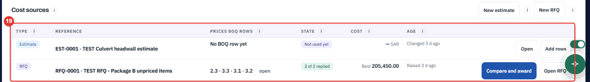
20. Click **Add rows** to give an estimate more BOQ rows to price. 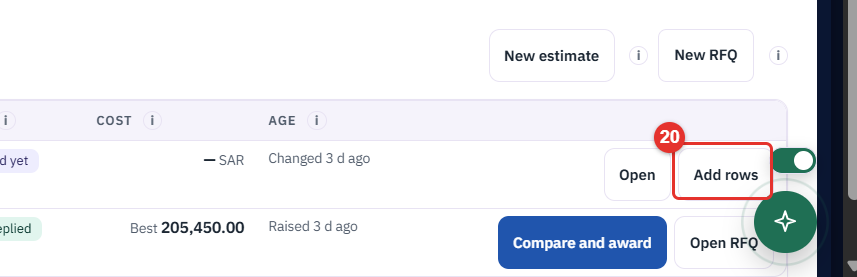
21. On a sent RFQ with replies, click **Compare and award**. 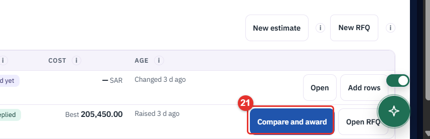
22. Suppliers appear side by side with **Lowest valid** marked. **Award and price** on a line writes cost plus markup into the BOQ rate. (Not clicked in this guide.) 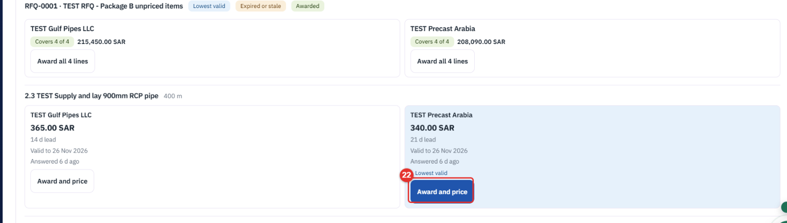
23. For an estimate, click **Open**. 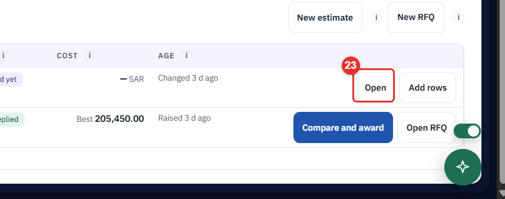
24. The estimate shows its tender at the top. Click **Back to Costing** to return. When the estimate prices a BOQ row the link reads **Back to BOQ line n** and the row panel opens. There is no **Create quote** on a tender estimate. 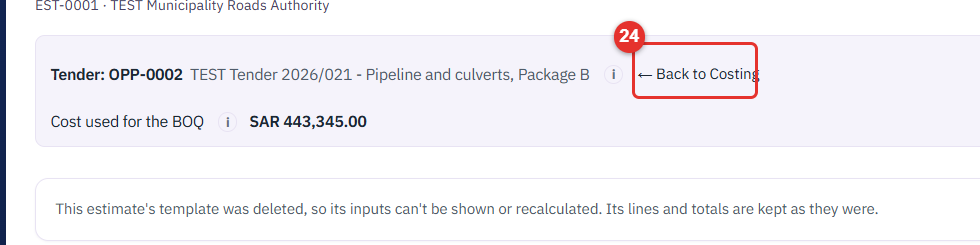

## E. The bid

25. Click **Bid**. 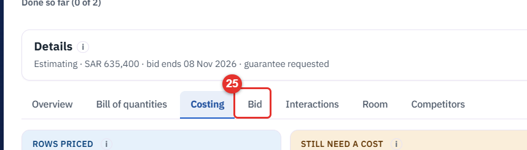
26. Read **Before you submit**. It lists what is missing: unpriced lines, old prices, no approved go decision, bid guarantee not marked Submitted. 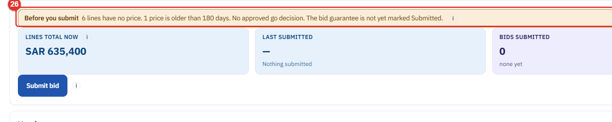
27. Choose **Payment terms**. The template's milestones show under it. Templates are edited in Settings. The choice prints on the bid documents and is saved on the submitted version. 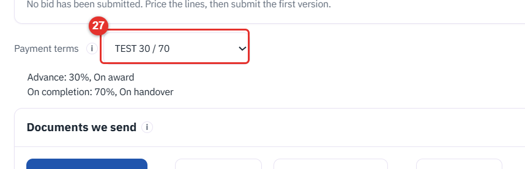
28. Under **Documents we send**, click **Send by email** next to **Download priced BOQ** (or next to **Export answer sheet**). Costs and markup are never in the file. 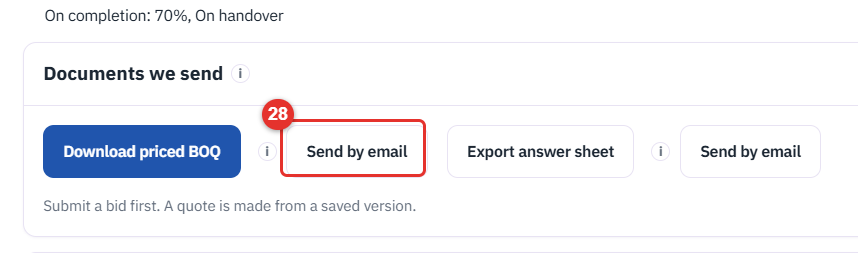
29. In the side panel, click **To** and type the client's address. Add a **Note** if you like. 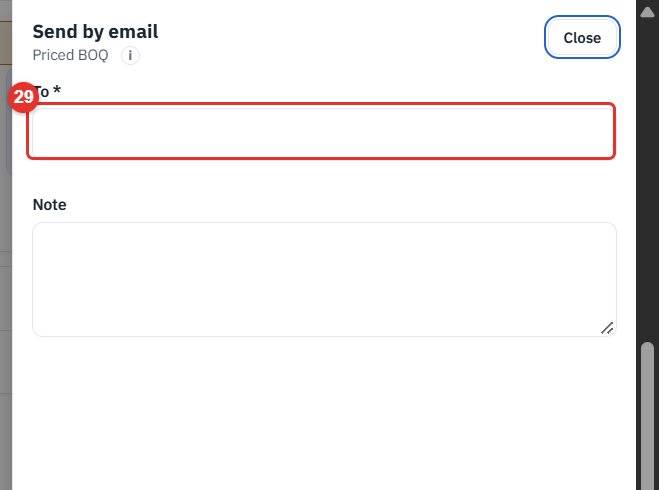
30. Click **Send**. The mail goes through the tender and is logged under **Sent to client** and in Outbound emails. (Not clicked in this guide.) 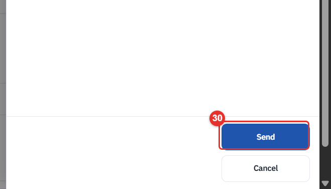
31. For a portal upload or a mail sent elsewhere, click **+ Record a send** under **Sent to client**. (The panel was not opened in this guide.) 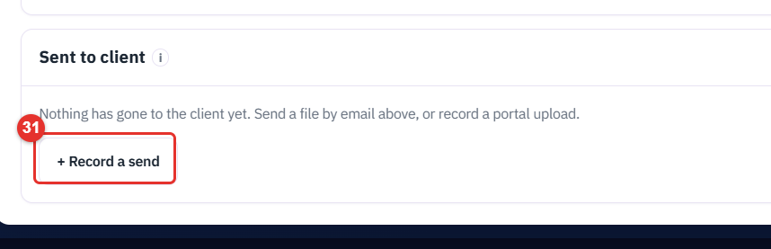
32. Click **Submit bid**. It saves the lines and total as the next numbered version and moves the tender to Submitted. Cost and markup are never saved in a version. To change a bid later use Revise bid; the next submit is the next version. 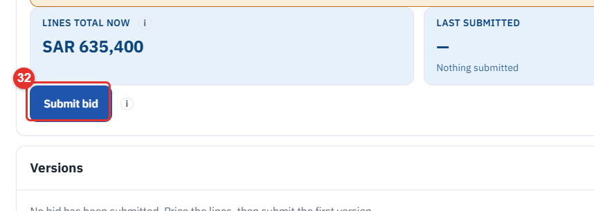

## F. Talking to the client and the team

33. Click **Interactions**. 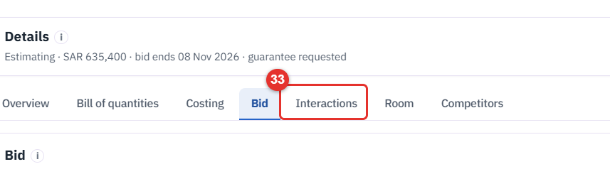
34. Click **New email** to write to the client from the tender. Sent mail, replies and the source email form one timeline here. This tender has none yet. 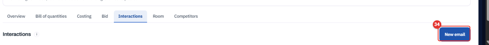
35. In the panel, click **To**, then write the **Subject** and **Message**. (Not sent in this guide.) 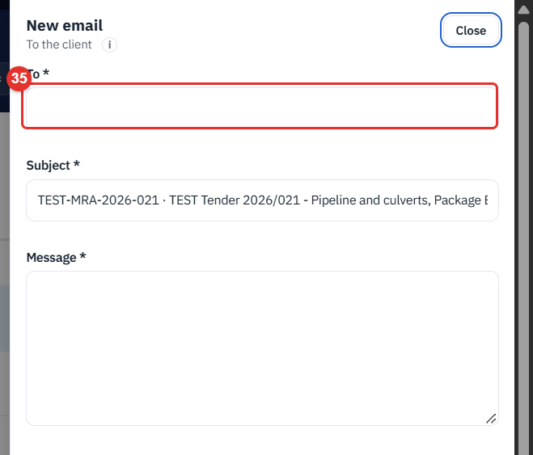
36. Click **Room** for the internal team room. It is never visible to the client. 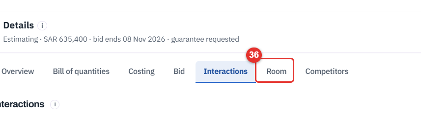
37. The room has four sub-tabs: **Discussion, Team, Decisions, Documents**. 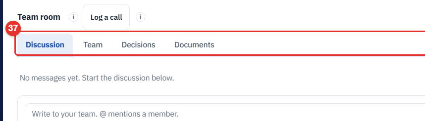
38. **Team**: who is in the room and **Add by name...**. 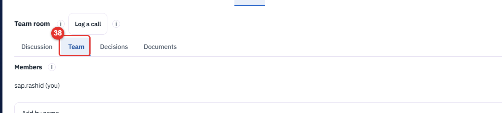
39. **Decisions**: pin one-line decisions ("Agreed to..."). 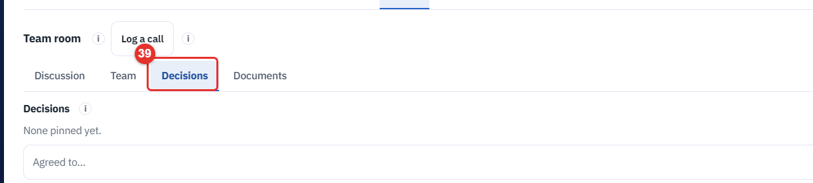
40. **Documents**: files attached to messages in Discussion. 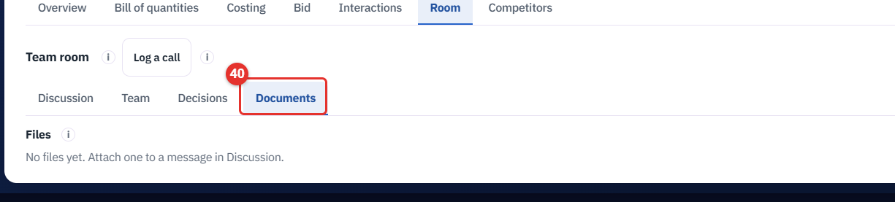

## G. Competitors

41. Click **Competitors**. 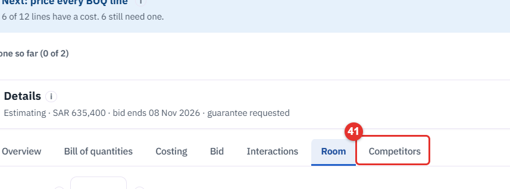
42. Click **Add competitor** to add one yourself. 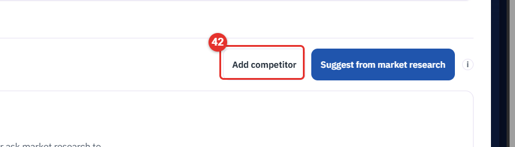
43. Click **Suggest from market research** for proposals with a source for every fact. It uses part of your AI allowance, so use it once per tender. 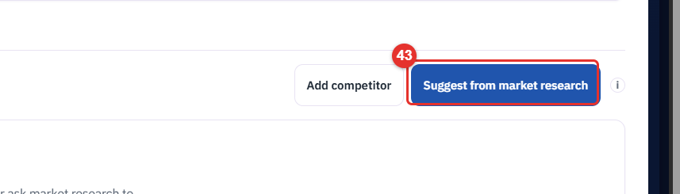
44. It first asks what it needs (supply only or supply and install, region, who issues the tender). Click an answer. Nothing runs until all three are answered. 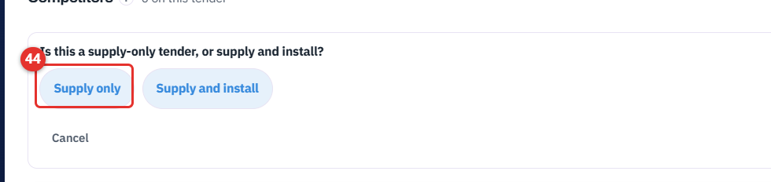
45. The **Add competitor** panel: **Company**, **Website**, **Country**, **Expected price**, **Strengths**, **Note**, then **Save**. 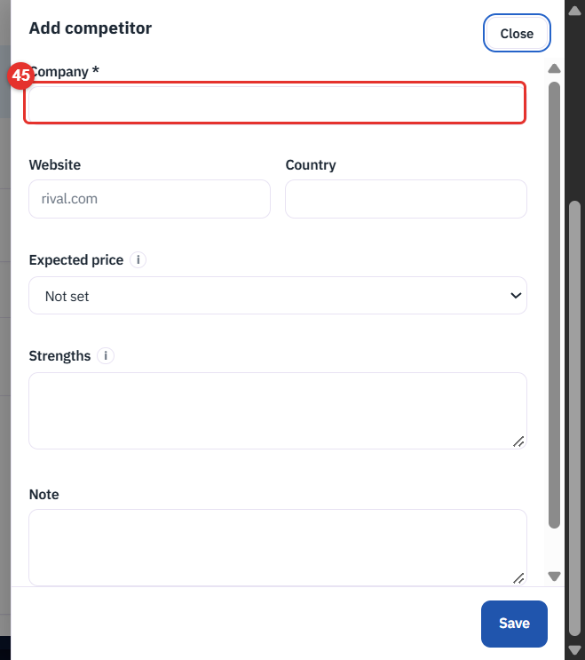

The list shows only Company, Expected price and Status (**Proposed** or **Added by you**). Click a row for the evidence, with a link to its source, and for Accept, Reject, Edit and Remove. This tender has no competitors yet, so the list was not captured.

## H. The contract project

The project exists only after the tender is won. In the tender, set the outcome to Won; the Next row then offers **Create contract project**, and later **Open contract project**.

46. Open **Contract Projects** and click **Open** on a project. 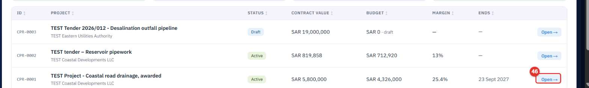
47. Click **Tender OPP-0004** (top left) to go back to the tender it came from. 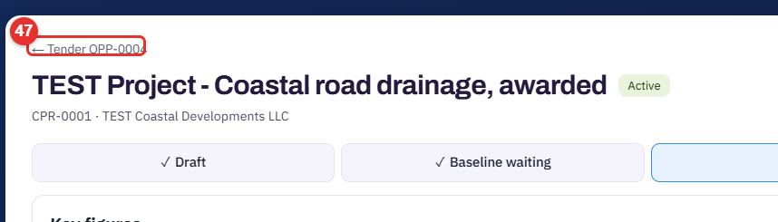
48. Read the project path: **Draft, Baseline waiting, Active, Handed over, Closed**. 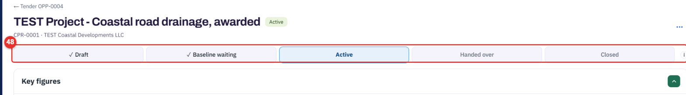
49. **Key figures**: **Contract value**, **Budget**, **Planned margin**. The section collapses. 
50. **Needs you** lists what a person must fix, each with a **Fix** link. 
51. **Where the budget goes**: one bar of the contract value, the budget by cost type, the rest is your margin. 
52. Click **Budget**. 
53. **Allocate by**: **BOQ line** (type a cost on each line) or **Work package** (type one cost per package). You can switch until the baseline is approved; switching clears typed costs after a confirmation. Here the baseline is approved, so the choice is locked. 
54. Three figures: **Contract value**, **Allocated**, **Margin so far** (contract value less what you allocated, live). It turns amber under the **Margin floor** and red when over-allocated. 
55. In the table, type a cost in **Allocated cost** for each line. **Left** is the client's amount less your cost. **Fill from tender costs** (next to **Allocate by**) copies the costs recorded on the tender once; it shows only when the project came from a tender with recorded costs. 
56. Click **Work breakdown (WBS)** to group BOQ lines into work packages, each with an owner. 
57. **New work package** (code, name, owner, lines). It is greyed here because the baseline is approved ("Locked"). Unassigned lines are listed in amber. 
58. Click **Buy-out**. 
59. Three tiles: **Packages**, **Ordered vs budget**, **Needs decision**. 
60. One row per package: **Budget**, **Best quote**, **Ordered**, **Against budget**, **Status**, **ePROMIS**. 
61. Click **Client changes**. 
62. **Client change orders**: changes the client asks for after the award. An approved one moves the contract value and opens a budget revision. 
63. Click **Client billing**. 
64. Click **+ Add milestone** to build the billing schedule. If the winning bid carried a payment-terms template, **Copy the tender's payment terms** makes the milestones for you. It shows only when the schedule is empty. 
65. Click **Handover**. 
66. **Hand over to the ERP**: click **Download Excel** for the budget file. 

### A new project: nothing allocated yet

67. A project made from a won tender starts with the client's contract lines and no costs. **Margin so far** reads **Not allocated yet** until you type a cost. 

### Settings, Contract projects

68. **Payment terms**: a few templates (name and milestones). Click **+ New template**, or **Open** one. 
69. **Margin floor**: the percent under which a project's margin turns amber. It reads **Not set** until you type one. 

## Phone view

On a phone (375 px) each screen is one column. The path scrolls sideways, the Next row stacks its buttons full width, tiles stack, and tables keep their key columns. Tap targets are 44 px.

## Not shown in this guide

These screens had no data on the capture workspace, or opening them would have changed data: the **Propose bid decision** panel, the **Record a send** panel, a competitor list with rows and its evidence panel, an Interactions timeline with mail in it, **Fill from tender costs**, Work package mode with packages, **Copy the tender's payment terms**, and a Won tender with its **Contract project** link.
